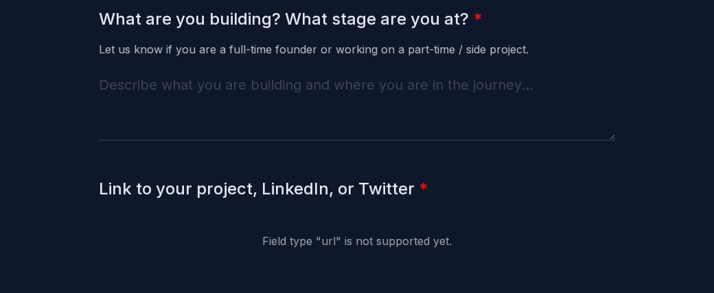
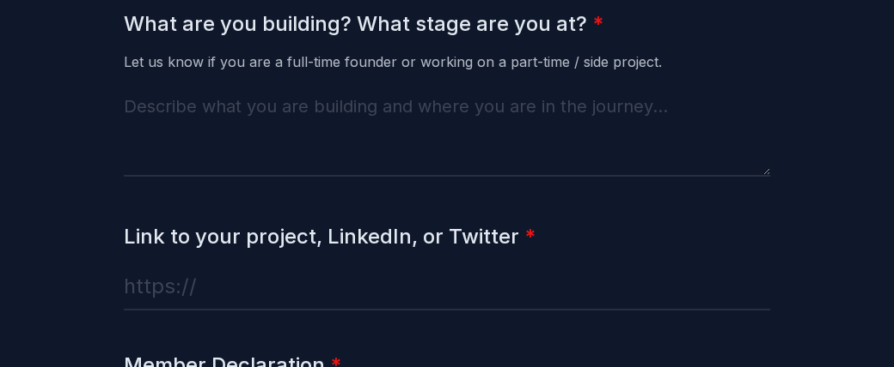
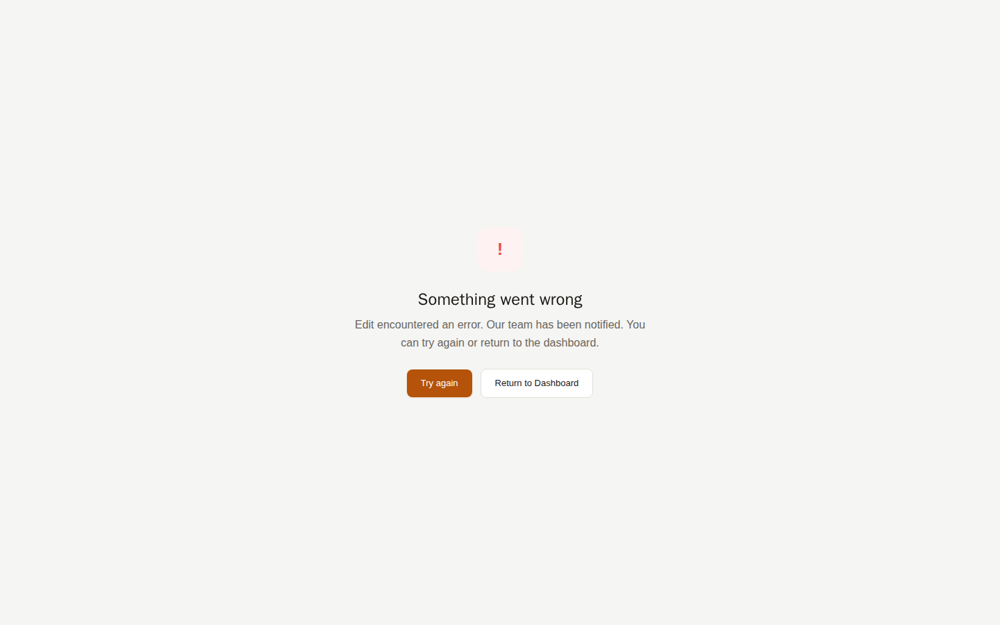
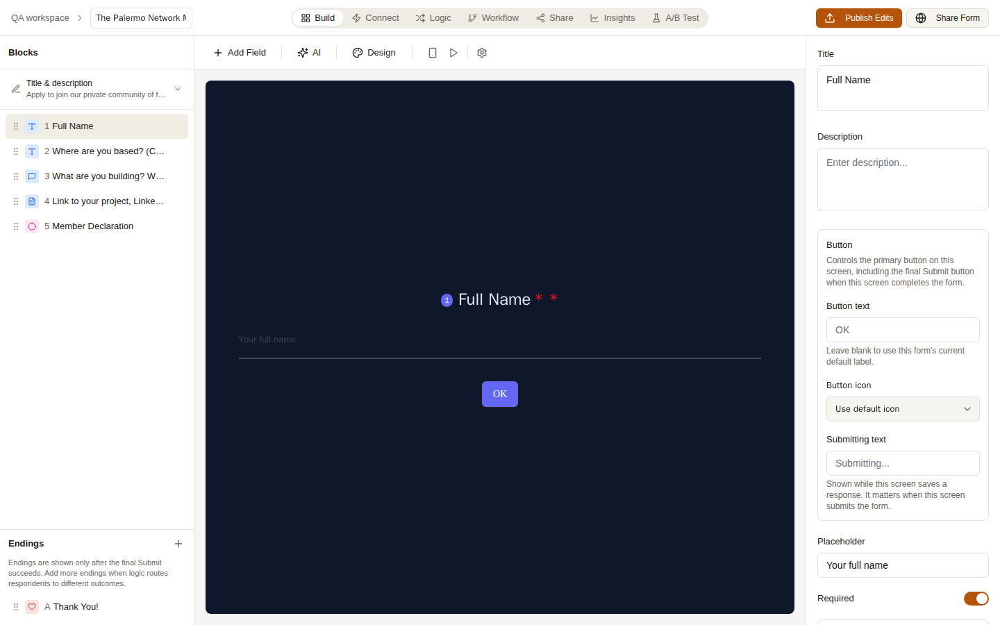
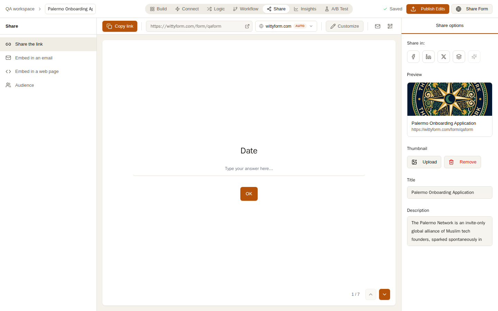
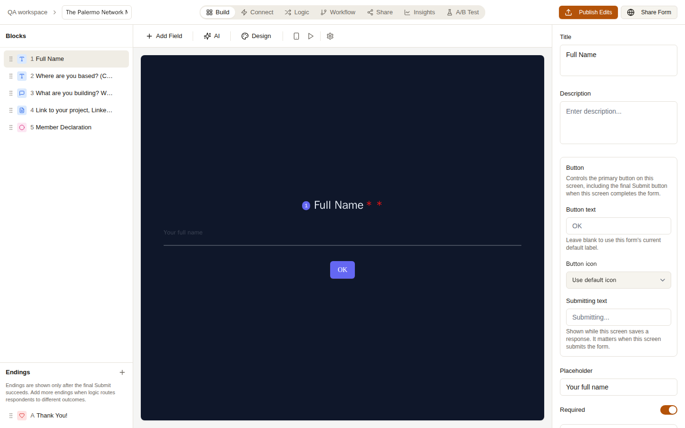
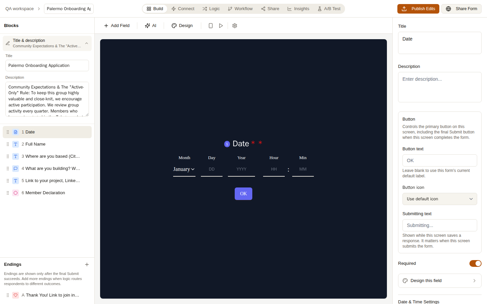
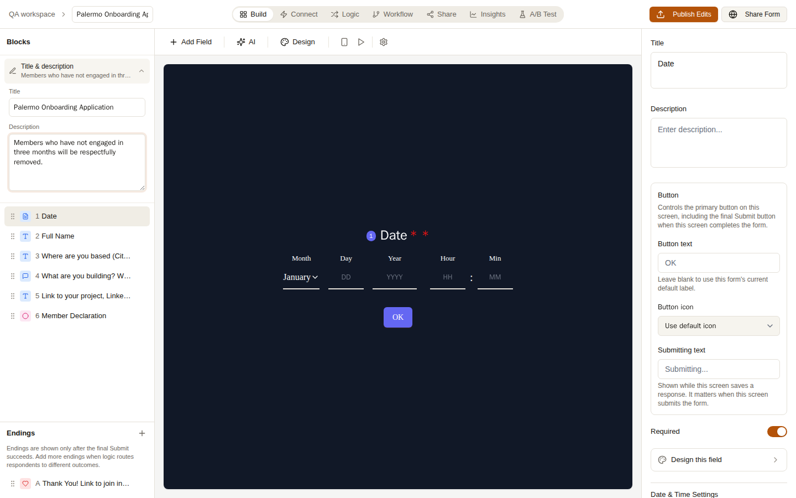

# WittyForm fixes, November 9, 2026

A customer reported three problems: some forms gave an error, they couldn't change a form's description, and Google Sheets wouldn't connect. Below is each problem before and after the fix.

## 1. A required question people could not answer

The form had a required question for a link (LinkedIn, Twitter or a website), saved under an old name WittyForm didn't recognise. Instead of a box to type in, the form showed "not supported", so nobody could ever send it.

**Before:** no box, so the form could never be sent.

**After:** the question has a box, and a plain address like `linkedin.com/in/name` is accepted.

## 2. "Something went wrong" when opening a form

The customer had added a share picture to three forms. WittyForm saved the whole picture inside the form instead of uploading it, which made each form about 3 MB. The builder keeps a copy of the form in the browser, the browser refused something that large, and the builder crashed.

**Before:** opening any of those three forms showed this error.

**After:** the builder opens. Share pictures are now uploaded as normal image files, the customer's three pictures were moved out of their forms, and the builder no longer crashes even if a form is very large.

The share picture is now a normal uploaded image (Share tab, right side):

## 3. Changing the form's title and description

The text under the form's title could only be set when the form was created. Nothing in the builder let you change it afterwards.

**Before:** nothing in the left panel lets you edit it.

**After:** a "Title & description" item at the top of the left panel opens both for editing.

## 4. Google Sheets: "The API developer key is invalid"

This one is a Google Cloud setting, not a WittyForm bug. "Browse Drive" opens Google's own file picker, and Google only allows it once the Google Picker API is turned on for WittyForm's key. Until that's done, you can connect a sheet by pasting its address into the box next to "Browse Drive".
